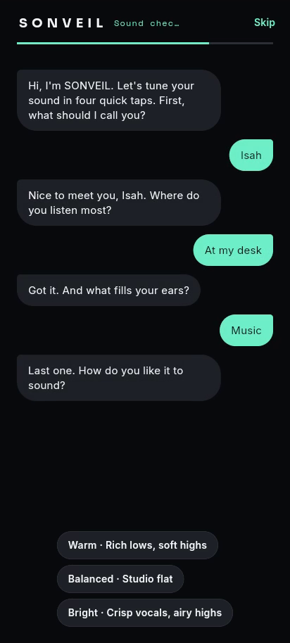
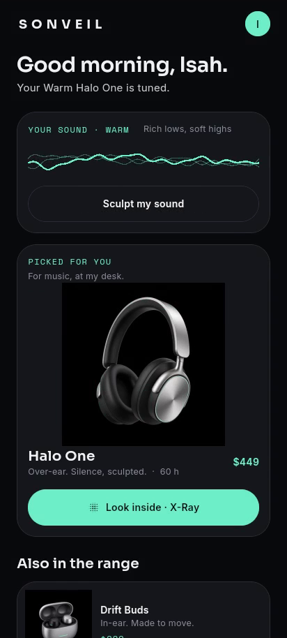
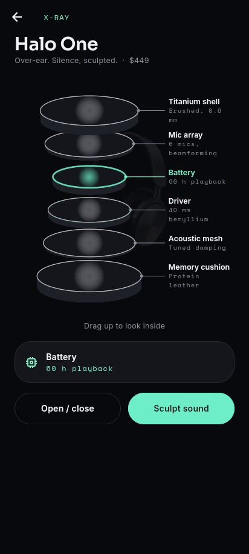
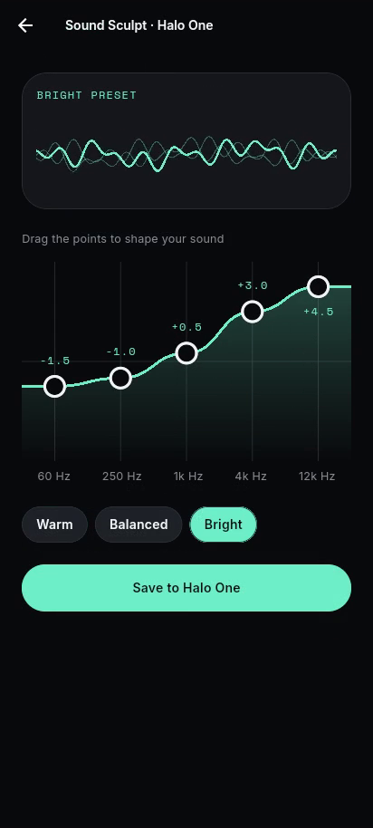

# SONVEIL · Premium Audio

Day 5 of my public **10-day Flutter challenge** (2026-10-25): 10 days, 10 brands, 10 apps.
**SONVEIL** is a *fictional* premium audio brand: over-ear headphones, earbuds and a speaker. It is not a real company, it is not affiliated with any audio maker, and every product name, spec and price in the app is invented. Product images were AI-generated for this demo.

Electronic gadgets were suggested by **Emmanuel Oleh** in the comments on Day 3.

| Sound check | Personalised home | X-Ray Exploded View | Sound Sculpt |
|---|---|---|---|
|  |  |  |  |

## Brand
- **Palette:** Obsidian `#0A0B0D`, Carbon `#15171B`, Titanium `#C9CDD3`, Mist `#F2F4F5`, Halo Mint `#6EF0C8` (accent), Ember `#FF7A59` (sparingly)
- **Type:** Sora for display and the wordmark, Inter for body text, Space Mono for specs and labels (all SIL OFL 1.1, bundled).

## What's new today (vs Days 1–4)
- **Onboarding is a chat, "Sound check".** SONVEIL asks four questions with a typing indicator: your name, where you listen (On the move / At my desk / Training / At home), what you listen to (Music / Podcasts / Calls / Gaming) and how you like it to sound (Warm / Balanced / Bright). Replies are tappable chips. **Skip** is visible the whole time and goes home with the defaults ("Listener").
- **Tuning reveal:** a flat line morphs into your sound curve while five EQ bars rise, then the app moves on to home.
- **Home adapts to your answers:** "Good evening, Isah." and "Your Warm Halo One is tuned." The lead device comes from your answers (training or calls → Drift Buds, at home → Orbit speaker, otherwise → Halo One), with a live "Your sound" waveform and the rest of the range below.
- **Signature: X-Ray Exploded View.** Drag up on the product and a scan line sweeps the photo, then the device separates into its painted internal layers (shell, mic array, battery, driver, mesh, cushion…) with leader-line labels. Tap a layer to read its spec. Release past halfway and it settles open, otherwise it closes.
- **Sound Sculpt:** a draggable 5-band EQ (60 Hz to 12 kHz, ±6 dB, snapped to 0.5 dB) with a live waveform that follows the curve, presets and a mock "Save". Nothing leaves the device.

## Architecture
```
lib/
  core/        constants, demo, routing, theme (tokens), utils, widgets (AppButton, AppText, AppTextField, CarbonPanel, BrandWordmark)
  features/
    listener/    domain (ListenerProfile, ListenPlace, ListenFor, SoundTaste), presentation (ListenerCubit)
    catalog/     data (LocalDeviceRepository), domain (Device, DeviceLayer, DeviceRepository)
    onboarding/  presentation (OnboardingCubit + state, chat widgets, demo tour)
    home/        domain (HomeBriefing, HomePersonaliser), presentation
    tuner/       domain (EqCurve, SoundShape), presentation (SculptCubit, LiveWave, EqCanvas, tuning + sculpt pages)
    xray/        domain (XrayMath), presentation (XrayCubit, XrayPainter, XrayStage, page)
```
- **State management: Cubit** (flutter_bloc). ListenerCubit holds the profile app-wide; OnboardingCubit, SculptCubit and XrayCubit are scoped to their pages. Per-frame values (explode progress, wave phase) live in AnimationControllers that drive CustomPainters through `repaint:`, never in a Cubit.
- Pure Dart logic (HomePersonaliser, SoundShape, EqCurve, XrayMath) is unit tested.

## Run
```bash
flutter pub get
flutter run                                   # normal
flutter run --dart-define=DEMO_TOUR=true      # plays the hands-free demo tour
flutter test
```

## Licence
MIT. See [LICENSE](LICENSE).
